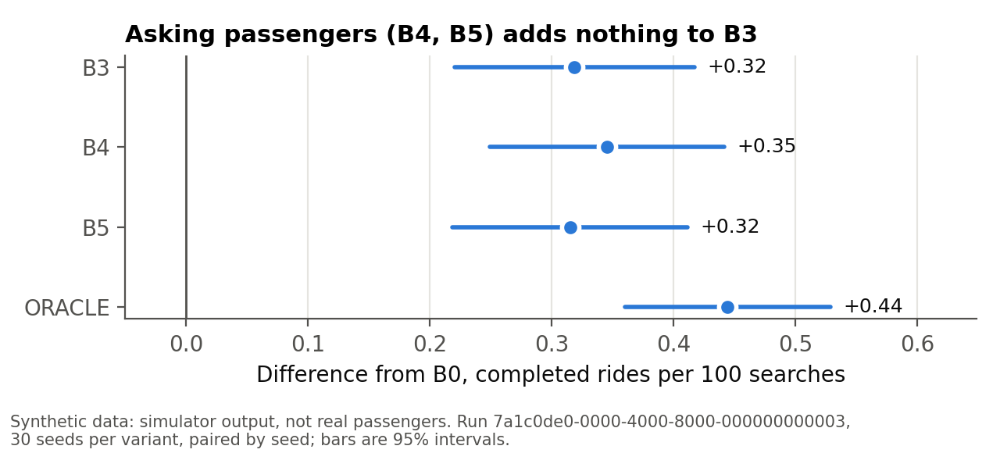
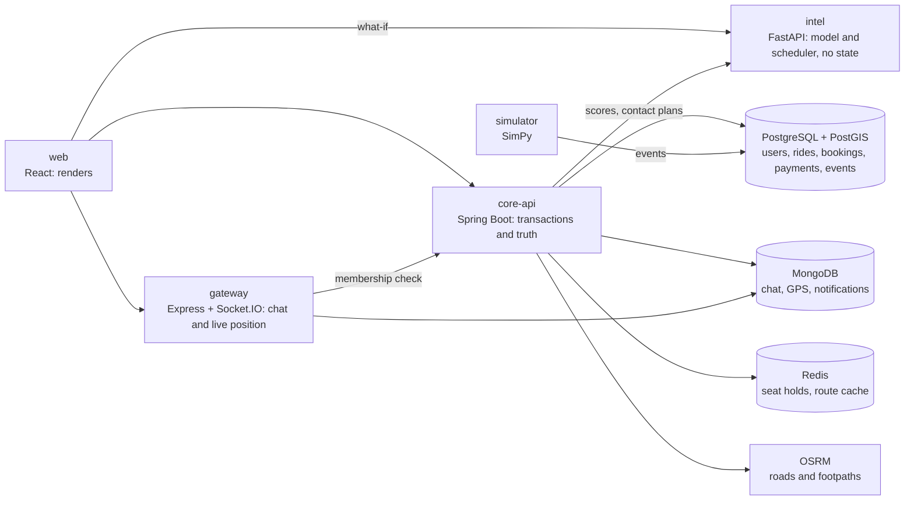

# VAYORA

[](https://github.com/shivampatil4972/VAYORA-/actions/workflows/ci.yml)

AI-powered intercity ride-sharing for the Kolhapur to Pune corridor (~230 km), built to
test one idea about cancellations.

Final-year B.Tech project, CSE (Data Science), DYPCET Kolhapur, team of four.

## The idea under test

**An early cancellation is a success.** A seat released three days before departure gets
refilled and the journey completes; the same seat released two hours before departure is
destroyed capacity. VAYORA models how long a booking will last as a survival curve over
the seven-day booking horizon, and acts on it while action still helps.

The measure is **completed rides per 100 searches**, never bookings: a platform can take
more bookings and still move fewer people.

## At a glance

| | |
|---|---|
| Features | 83 of 95 verified, 11 partial, 1 not started: about 93% counting a partial feature as half ([feature matrix](docs/FEATURE_MATRIX.md)) |
| Tests | 304 Java, 232 web, 206 Python, 28 gateway, all passing ([what each covers](docs/TESTING.md)) |
| Languages | English, Hindi and Marathi, on every screen, notification and error message |
| Research | A SimPy simulator of the corridor: 60 simulated days, 30 seeds per variant, train and validation on disjoint seeds |
| Data | All synthetic, plus one public dataset of real hotel cancellations used as a check |

## What the research found

The answer so far is **no, not in this simulated world**, and the project reports it that
way.



| Variant | What it does | Completed rides per 100 searches |
|---|---|---|
| B0 | Shows rides closest to the passenger's preferred time | 30.77 |
| B3 | Ranks rides by how likely each booking is to last | 31.11 (+0.34) |
| B4 | As B3, and asks passengers whose booking looks shaky to release it early | 31.10 |
| B5 | As B4, within a contact budget, a CP-SAT scheduler choosing whom to ask | 31.10 |
| ORACLE | Asks exactly the bookings that will cancel late | +0.10 over B3 |

- **Asking works on timing but not on rides.** B4 cuts the share of late cancellations by
  5.6 points, but completed rides do not move (−0.01, 95% interval −0.04 to +0.03).
- **Even perfect targeting adds little.** An oracle that knows who will cancel late gains
  only +0.10, because late releases are already refilled 68% of the time against 94% for
  early ones, and supply, not timing, is what runs out: over half of all searches find no
  ride.
- **The one gain needs no personal data.** B3's +0.34 comes from timing alone; a model that
  knows nothing about the passenger does as well, and the scheduler does no better than
  choosing at random.
- **On real hotel cancellations, features do help.** The same kinds of model rank who
  cancels better than lead time alone (concordance 0.597 for Cox and 0.653 for gradient
  boosting, against 0.544), which suggests the simulated world understates what booking
  features can tell.

Every number above is a SQL query over the event log, reproducible with one script. The
method is in [AI_ML_METHODOLOGY](docs/AI_ML_METHODOLOGY.md), every run and its intervals
in [EXPERIMENT_PROTOCOL](docs/EXPERIMENT_PROTOCOL.md), and the seven report figures in
[docs/figures](docs/figures/README.md).

## What the platform does

**Passengers** search by town or by exact points on a map and see, for each ride, the walk
to the pickup on real footpaths, an auto-rickshaw estimate with the published meter fare
where one exists, the driver's record of rides kept, and a match score for both sides.
They can hold seats for five minutes while deciding, book or request, choose what happens
if the driver withdraws (this ride only, or rebook automatically), be picked up off the
stops where the driver allows a detour, chat with the driver, follow the driver's live
position, call through a masked number, show a boarding code, confirm the trip happened,
rate it, and keep receipts in their own language. Travel passes waive the service fee.

**Drivers** add vehicles (electric ones with their range, which publishing respects),
publish rides with intermediate stops, per-stretch prices from the road route, a return
trip and weekly repeats, set how far they will go out of their way, accept or decline
requests, start the ride, check boarding codes, mark no-shows, complete, and see earnings
and their own reliability record. They are told when passengers searched a stretch they
drive and found nothing.

**Every member** has a profile with photo and preferences, confirms an email or phone by
code, keeps emergency contacts, and has an emergency button that puts **112** first. A
seat-release reminder 48 hours before boarding asks, without any penalty, whether plans
have changed.

**Administrators** have a back office: reports and moderation, the emergency queue,
members, rides and bookings, disputed trips, bus alternatives, rest stops and chargers,
unmet demand, the audit log, the durability model's scores with the reason behind each,
and a what-if page that runs the simulator live at a setting no saved sweep covered.

What is simulated, mocked or missing is listed plainly in
[KNOWN_LIMITATIONS](docs/KNOWN_LIMITATIONS.md). The model never cancels, prices or
refuses anyone: the only thing it decides is whom the seat-release reminder asks.

## Architecture



Spring Boot owns transactions and truth, FastAPI owns inference and holds no state, Express
owns ephemeral streams only, and React renders. No entity lives in two stores. Why each
thing lives where it does is in [ARCHITECTURE](docs/ARCHITECTURE.md).

## Quick start

Requires Docker with Compose v2. Nothing else needs to be installed.

```sh
docker compose up -d --build --wait
sh infra/check-health.sh
```

Then open **http://localhost:5173** and create an account as a passenger or a driver.

The first run downloads a ~220 MB OpenStreetMap extract and builds the road and footpath
graphs; later runs reuse the volume and start in seconds.

| Service | Role | Health |
|---|---|---|
| web | React app | http://localhost:5173/health |
| core-api | Spring Boot 3, Java 21 | http://localhost:8080/actuator/health |
| intel | FastAPI, Python 3.11 | http://localhost:8000/health |
| gateway | Express 4 + Socket.IO 4 | http://localhost:3000/health |

Backing services: PostgreSQL 16 + PostGIS 3.4 (`5432`), MongoDB 7 (`27017`), Redis 7
(`6379`), OSRM (`5000`).

**An administrator** cannot sign up. Copy `.env.example` to `.env`, set `ADMIN_EMAIL` and
`ADMIN_PASSWORD` (12 characters or more), and restart core-api.

**The API** is described at http://localhost:8080/swagger-ui.html: every endpoint, with
its fields, tried from the page once **Authorize** has the token sign-in returns.

**Demo data**, to see the platform with rides in it (needs Node 20):

```sh
DEMO_PASSWORD=<8 or more characters> node scripts/demo-data.mjs
```

Four drivers, six days of corridor rides each way, and two passengers with seats booked,
all signing in with that password. Every demo account says in its profile that it is made
up, and nothing it does reaches the research figures, which are computed per simulation
run. It refuses any API but this machine's.

**A port already in use?** Every host port is a `*_PORT` setting in `.env`;
`check-health.sh` reads the same variables:

```sh
cp .env.example .env
set -a; . ./.env; set +a; sh infra/check-health.sh
```

## Real services, off until you switch them on

Out of the box nothing leaves the platform: payments are simulated and no money moves,
codes and messages go to a simulated outbox an administrator can read, and calls are
simulated. Each real service below turns on when its settings are in `.env`. Each is
tested against a stand-in; none has yet been tried against the real service.

| Service | What it switches on | Settings |
|---|---|---|
| Google | "Sign in with Google" | `GOOGLE_CLIENT_ID` |
| Razorpay, test mode | Paying by card, UPI or wallet in Razorpay's checkout, refunds through Razorpay | `RAZORPAY_KEY_ID`, `RAZORPAY_KEY_SECRET` |
| Twilio | Codes, notification copies and emergency texts by SMS; masked calls bridged through the platform's number | `TWILIO_ACCOUNT_SID`, `TWILIO_AUTH_TOKEN`, `TWILIO_FROM` |
| Any SMTP server | Codes and notification copies by email | `SPRING_MAIL_HOST`, `SPRING_MAIL_PORT`, `SPRING_MAIL_USERNAME`, `SPRING_MAIL_PASSWORD`, `JOURNEX_MAIL_FROM` |
| Web Push | Push notifications in the browser | `JOURNEX_PUSH_PUBLIC_KEY`, `JOURNEX_PUSH_PRIVATE_KEY` (`node scripts/vapid-keys.mjs` makes a pair) |

`.env` is never committed. Every setting and what breaks is in
[DEPLOYMENT](docs/DEPLOYMENT.md).

## Tests

```sh
docker compose --profile test run --rm core-api-tests      # core-api: Java 21, real PostGIS, MongoDB and Redis
docker compose --profile research run --rm research        # event log, simulator, model, scheduler, experiments, intel
(cd web && npm ci && npm test)                             # React screens, translations, money and dates
(cd gateway && npm ci && npm test)                         # real Socket.IO server and clients
```

The Python suite needs PostgreSQL running (`docker compose up -d --wait postgres core-api`)
and works in a throwaway schema. Two tests keep the languages honest: one fails if the app
shows text that is not translated, the other if the server can send a message the app
cannot translate.

## Reproducing the research

```sh
scripts/reproduce.sh               # tests, model, ladder and sweeps, about an hour
scripts/reproduce.sh --no-sweeps   # tests, model and ladder only
```

It rebuilds every current result from the configuration in `experiments/configs/` and
fails unless each one comes out exactly as committed. The first run downloads the public
hotel bookings and checks their SHA-256.

Single steps:

```sh
# Train and evaluate the durability model
docker compose --profile research run --rm research python -m experiments.hazard.train

# Run one variant on the 30 experiment seeds
docker compose --profile research run --rm research python -m sim.run --variant experiments/configs/variants/B4.yaml
```

Every threshold, budget and assumed value lives in `experiments/configs/*.yaml`, none in
code. Latent passenger types drive behaviour in the simulator and are never model features.

## The event log

Every number in the report is a SQL aggregate over one table, `events`, through
[`experiments/analysis/metrics.sql`](experiments/analysis/metrics.sql). Two writers share
it and a fixed vocabulary of 22 event types: core-api's `EventLogService`, which never
throws into its caller, and the Python `journex_events` writer, which fails loudly. The
platform and the simulator speak the same vocabulary; the platform's own rows sit outside
every simulation run.

## Documents

| Document | What it answers |
|---|---|
| [ARCHITECTURE](docs/ARCHITECTURE.md) | What the parts are and why things live where they do |
| [DATABASE_DESIGN](docs/DATABASE_DESIGN.md) | Every table, collection and key |
| [API_DOCUMENTATION](docs/API_DOCUMENTATION.md) | Every endpoint and who may call it |
| [SECURITY](docs/SECURITY.md) | What is protected, how it is checked, and what is missing |
| [DEPLOYMENT](docs/DEPLOYMENT.md) | Running it, configuring it, and what breaks |
| [FEATURE_MATRIX](docs/FEATURE_MATRIX.md) | The state of each of the 95 features, and the evidence for it |
| [TESTING](docs/TESTING.md) | What is tested, and what is not |
| [KNOWN_LIMITATIONS](docs/KNOWN_LIMITATIONS.md) | Everything that does not work, is simulated, or could be mistaken for more |
| [AI_ML_METHODOLOGY](docs/AI_ML_METHODOLOGY.md) | The survival models, their explanations and the contact scheduler |
| [EXPERIMENT_PROTOCOL](docs/EXPERIMENT_PROTOCOL.md) | How variants are compared, and every result with its interval |
| [Figures](docs/figures/README.md) | The report's seven figures, with captions |
| [DATASET_DOCUMENTATION](docs/DATASET_DOCUMENTATION.md) | Where every dataset comes from |
| [DECISIONS](docs/DECISIONS.md) | Every design decision, why, and what it costs |
| [IMPLEMENTATION_ROADMAP](docs/IMPLEMENTATION_ROADMAP.md) | What is left and what it needs |
| [PROGRESS](docs/PROGRESS.md) | What was built when |

The binding project rules (frozen parameters, the architecture rule, research integrity)
are in [CLAUDE.md](CLAUDE.md).

## Repository layout

| Path | What |
|---|---|
| `web/` | Vite + React 18 + TypeScript + Tailwind |
| `core-api/` | Spring Boot 3, Java 21, `com.dypcet.journex`, Flyway migrations |
| `intel/` | FastAPI, Python 3.11: durability model, explanations, contact scheduler, live what-if |
| `gateway/` | Express 4 + Socket.IO 4, JWT verification |
| `sim/` | SimPy simulator of the corridor |
| `journex_events/` | Python event-log writer and the event vocabulary |
| `experiments/` | Configs (every tunable number), runners, analysis queries and committed reports |
| `infra/` | OSRM corridor preparation, stack health check |
| `scripts/` | `reproduce.sh`, push key generation |
| `docs/` | Report material and figures |

OSRM serves a clipped bounding box: `infra/osrm/prepare.sh` downloads Geofabrik's western
India extract and clips it to the corridor (`OSRM_BBOX`, default `73.4,16.4,74.9,18.9`).
To rebuild from scratch: `docker compose down && docker volume rm journex_osrmdata`.

## Data and credits

- Map data © [OpenStreetMap](https://www.openstreetmap.org/copyright) contributors (ODbL),
  routed with OSRM.
- Hotel bookings: Nuno Antonio, Ana de Almeida and Luis Nunes (2019), *Hotel booking demand
  datasets*, Data in Brief 22, 41–49, [doi:10.1016/j.dib.2018.11.126](https://doi.org/10.1016/j.dib.2018.11.126),
  CC BY 4.0.
- Everything else is synthetic, generated by the simulator under the assumptions in
  `experiments/configs/world.yaml`. Nothing here is evidence about real passengers.
